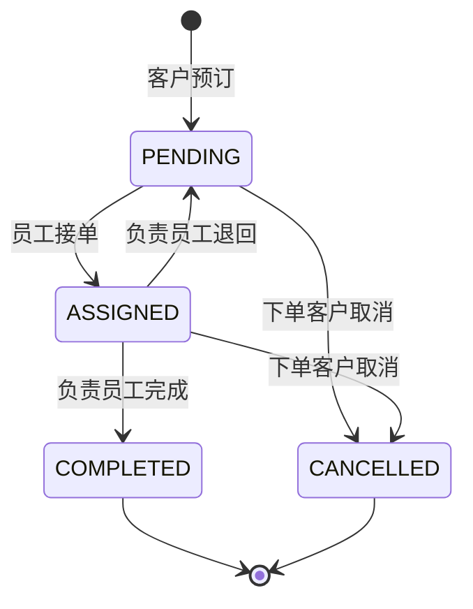

# 架构与业务设计

## 请求如何经过系统

React 页面通过统一请求层访问 `/travel/api`。后端先检查会话及 CSRF，再进入 Controller 校验输入，Service 处理权限和业务规则，Repository 执行参数化 SQL。HTTP 接口返回明确状态码和可读错误，页面显示加载、成功或失败状态。

使用 JDBC 保留对 SQL、表关系和事务的可见性，便于在课程项目与面试中解释。H2 提供不依赖外部服务的本地运行环境；Flyway 管理表结构版本，另有 MySQL 配置入口。

## 三张核心表

- `app_users`：账号、显示姓名、密码散列、电话、角色与启用状态。密码只用于校验，不进入用户响应模型。
- `travel_routes`：线路名称、目的地、日期、天数、价格、名额、上下架、描述及图片映射。
- `bookings`：客户、负责人、线路、出行人数、预订单价与总价快照、状态、联系人、备注和创建时间。

应用统一使用 READ COMMITTED 事务隔离，结合行锁后读取最新状态，并通过带旧状态条件的更新防止冲突操作覆盖。

订单外键保留历史关联。删除有关联记录的线路和账号会被拒绝，管理端可以改为下架或停用。

## 订单状态

只有下单客户可以取消自己的未完成订单，只有负责员工可以完成或退回订单。完成和取消为终态；重复或冲突操作返回错误。预订、改容量和状态修改需要后端事务及数据库条件约束。

## 订单变更留痕

`booking_events` 为每次状态变化保留一条记录：`booking_id`、`from_status`、`to_status`、`actor_id`、`actor_role`、`note`、`created_at`。`from_status` 可空，用来表示下单建档这一没有前序状态的起点；`actor_role` 是变更发生当时的角色，后续改角色不会篡改历史。

事件只追加，不更新也不删除。写入与状态变更共用同一个 `@Transactional` 边界：先用带旧状态条件的更新改订单，影响行数为 1 才追加事件，任一步失败整体回滚，因此不会出现"状态变了却没有记录"或"记了记录但状态没变"的订单。时间线按 `created_at` 排序，同一时刻的多条以自增 `id` 兜底，顺序稳定可复现。

演示数据由 `DemoData` 直接经仓储写入，不产生事件；时间线只覆盖真实业务操作产生的变更。

## 订单列表与分页

列表的可见性不再由应用层过滤，而是翻译成 SQL 条件：管理员不限范围；客户按 `customer_id` 等值过滤；员工是"待接池 + 自己名下"，即 `status='PENDING' OR employee_id=?`。状态与关键词在同一层 `WHERE` 里叠加，关键词按字面匹配订单号、线路名、客户名、联系人姓名与负责人姓名，`LIKE` 的 `%`、`_` 会被转义成普通字符。

`page` 与 `count` 共用同一个 `FROM` 与 `WHERE`，所以总数与当前页不会互相矛盾。排序只接受白名单键（创建时间、金额、出发日期），真实列名由仓储映射，最后一律以 `id` 倒序兜底，保证同一秒创建的订单翻页不重不漏。页大小上限在服务端兜底，前端传再大也不会拖垮查询。

`V3__add_booking_query_indexes.sql` 补了三条复合索引，列序都是"归属列 → `created_at` → `id`"，与三种角色的查询形状一一对应；`V1` 里的单列索引保留不动（删除属收缩性变更，不在新增范围内）。

## 金额与名额

预订总价 = 预订时线路单价 × 出行人数，金额在服务端用 `BigDecimal` 计算并保存。页面展示的是订单金额，不包含付款、退款或财务结算。

可用名额 = 线路容量 − 未取消订单的出行人数总和。取消后释放名额，已完成订单仍代表消耗过的该团名额。数据库中的演示订单也遵循相同口径。

## 安全与边界

- Spring Security 管理服务端会话，密码采用 BCrypt 散列。
- CSRF 令牌保护修改请求，登录后重新获取令牌。
- 后端同时检查角色、启用状态和业务记录归属。会话绑定不可变用户 ID 与凭据状态，避免同名账号重建继承旧会话；修改密码后需要重新登录。
- React 渲染用户文本，不把输入当作 HTML 注入。
- SQL 使用参数绑定，输入长度、人数、日期、金额有后端约束。
- 默认只允许本机访问，演示账号仅属于本地 demo 配置。

这是一套可运行的学习与展示项目，未实现支付、消息通知、地图接口、文件上传或多租户。旧 MySQL 数据迁移和对外上线需要独立实施，不包含在本次本地重构验收中。
