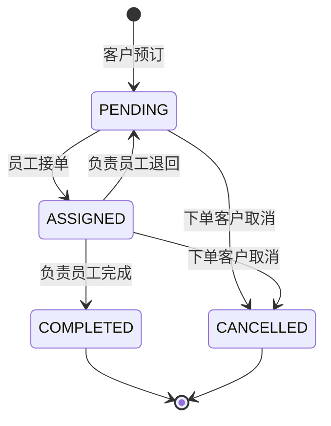

# 架构与业务设计

## 请求如何经过系统

React 页面通过统一请求层访问 `/travel/api`。后端先检查会话及 CSRF，再进入 Controller 校验输入，Service 处理权限和业务规则，Repository 执行参数化 SQL。HTTP 接口返回明确状态码和可读错误，页面显示加载、成功或失败状态。

使用 JDBC 保留对 SQL、表关系和事务的可见性，便于在课程项目与面试中解释。H2 提供不依赖外部服务的本地运行环境；Flyway 管理表结构版本，另有 MySQL 配置入口。

## 三张核心表

- `app_users`：账号、显示姓名、密码散列、电话、角色与启用状态。密码只用于校验，不进入用户响应模型。
- `travel_routes`：线路名称、目的地、日期、天数、价格、名额、上下架、描述及图片映射。
- `bookings`：客户、负责人、线路、出行人数、预订单价与总价快照、状态、联系人、备注和创建时间。

应用统一使用 READ COMMITTED 事务隔离，结合行锁后读取最新状态，并通过带旧状态条件的更新防止冲突操作覆盖。

订单外键保留历史关联。删除有关联记录的线路和账号会被拒绝，管理端可以改为下架或停用。

## 订单状态

只有下单客户可以取消自己的未完成订单，只有负责员工可以完成或退回订单。完成和取消为终态；重复或冲突操作返回错误。预订、改容量和状态修改需要后端事务及数据库条件约束。

## 订单变更留痕

`booking_events` 为每次状态变化保留一条记录：`booking_id`、`from_status`、`to_status`、`actor_id`、`actor_role`、`note`、`created_at`。`from_status` 可空，用来表示下单建档这一没有前序状态的起点；`actor_role` 是变更发生当时的角色，后续改角色不会篡改历史。

事件只追加，不更新也不删除。写入与状态变更共用同一个 `@Transactional` 边界：先用带旧状态条件的更新改订单，影响行数为 1 才追加事件，任一步失败整体回滚，因此不会出现"状态变了却没有记录"或"记了记录但状态没变"的订单。时间线按 `created_at` 排序，同一时刻的多条以自增 `id` 兜底，顺序稳定可复现。

演示数据由 `DemoData` 直接经仓储写入，不产生事件；时间线只覆盖真实业务操作产生的变更。

## 订单列表与分页

列表的可见性不再由应用层过滤，而是翻译成 SQL 条件：管理员不限范围；客户按 `customer_id` 等值过滤；员工是"待接池 + 自己名下"，即 `status='PENDING' OR employee_id=?`。状态与关键词在同一层 `WHERE` 里叠加，关键词按字面匹配订单号、线路名、客户名、联系人姓名与负责人姓名，`LIKE` 的 `%`、`_` 会被转义成普通字符。

`page` 与 `count` 共用同一个 `FROM` 与 `WHERE`，所以总数与当前页不会互相矛盾。排序只接受白名单键（创建时间、金额、出发日期），真实列名由仓储映射，最后一律以 `id` 倒序兜底，保证同一秒创建的订单翻页不重不漏。页大小上限在服务端兜底，前端传再大也不会拖垮查询。

页大小的归一是闭区间 1–100（0 与负数抬到 1，超过 100 压到 100），负页码按第 0 页处理，响应回显的是真正生效的值而不是请求值。这些边界与三种角色的 `total` 口径都在 `OrderPaginationTest` 里用原生 SQL 计数做对照——期望值不取自被测量的仓储实现，可见性一旦被改回内存过滤或漏掉某一层条件，用例立刻转红。5000 条订单时首页查询实测 9ms。

接口层 `GET /api/orders` 带 `page` 或 `size` 时返回 `{items,total,page,size}` 信封，不带分页参数时仍返回数组——旧调用方（冒烟脚本、旧版前端）不受影响，参数与错误语义见 `docs/API.md`。前端不再拉全表后本地切片：关键词停顿 300ms 再与状态、页码拼进查询串，翻页只换请求，内存里始终只有当前页。页签上的状态数字因此改为按状态各取一次 `total`（`size=1`，不取详情），用 5 次轻量请求换取"数字是全局口径"而不是当前页口径。

`V3__add_booking_query_indexes.sql` 补了三条复合索引，列序都是"归属列 → `created_at` → `id`"，与三种角色的查询形状一一对应；`V1` 里的单列索引保留不动（删除属收缩性变更，不在新增范围内）。

## 金额与名额

预订总价 = 预订时线路单价 × 出行人数，金额在服务端用 `BigDecimal` 计算并保存。页面展示的是订单金额，不包含付款、退款或财务结算。

可用名额 = 线路容量 − 未取消订单的出行人数总和。取消后释放名额，已完成订单仍代表消耗过的该团名额。数据库中的演示订单也遵循相同口径。

## 线路图片

线路卡片的图片有两个来源，按优先级回退：`image_path`（上传上来的真实文件，可空）优先，为空时用 `image_key`（6 个内置图片的映射键，保持 `NOT NULL`）。旧线路从未上传过图片，所以 `image_path` 可空且不回填，读出来是空值而不是占位值。

上传的图片只按文件头魔数判断真实格式（PNG、JPEG、WebP），扩展名只决定存盘后缀：把压缩包改名成 `.jpg` 会在写盘之前被拒，被拒时磁盘上不留残留文件；内容是真图但后缀对不上（PNG 存成 `.jpg`）同样拒绝，避免后缀与真实格式各说各话。单张上限 5MB，超出返回 413，与"格式不对"的 400 分开，前端才能给出不同提示。

存盘名由 UUID 生成，原始文件名一律丢弃，不让中文名、路径分隔符或 `..` 进入文件系统；表里只记这个文件名，根目录由 `travel.upload.dir` 配置，默认 `data/uploads`（不入库）。

上传只改 `image_path` 一列，不动线路的其他字段，因此和编辑表单互不覆盖。对外地址是 `/uploads/<文件名>`，由 `WebMvcConfig` 映射到上面那个目录——**不映射到** `src/main/resources/static`：后者是构建产物，重新打包会把上传的图清空。根目录只在 `travel.upload.dir` 里出现一次，上传服务与静态映射共用同一个解析结果。带 `..` 的请求在进入资源解析前就被判为非法，不存在的文件返回 404，两者都不会把目录外的文件读出来。

前端 `routeImage.ts` 的 `coverPath()` 是这条回退规则的唯一实现：有 `imagePath` 拼 `/uploads/...`，为空拼内置图片地址；`baseUrl` 作为参数传入，所以这条判断能脱离浏览器单独测试。

## 安全与边界

- Spring Security 管理服务端会话，密码采用 BCrypt 散列。
- CSRF 令牌保护修改请求，登录后重新获取令牌。
- 后端同时检查角色、启用状态和业务记录归属。会话绑定不可变用户 ID 与凭据状态，避免同名账号重建继承旧会话；修改密码后需要重新登录。
- React 渲染用户文本，不把输入当作 HTML 注入。
- SQL 使用参数绑定，输入长度、人数、日期、金额有后端约束。
- 默认只允许本机访问，演示账号仅属于本地 demo 配置。

这是一套可运行的学习与展示项目，未实现支付、消息通知、地图接口或多租户。图片只存在本机目录，没有对象存储、图片裁剪与 CDN 分发。旧 MySQL 数据迁移和对外上线需要独立实施，不包含在本次本地重构验收中。

## 在线咨询的数据基础

聊天使用新增的 `V4_1__create_chat.sql`，保留已有 V1–V4 迁移。`chat_conversations` 按客户与顾问配对唯一，双方已读游标默认 0；`chat_messages` 通过会话及发送者外键保留历史，按 `(conversation_id, sender_id, client_id)` 唯一约束防止重试插入重复消息。历史索引为 `(conversation_id, id)`。V4.1 仅新增表和索引，不修改订单、用户和线路已有数据。

聊天仓储按参与者过滤会话列表，历史消息以消息 ID 向前取 50 条并按正序返回。已读更新只允许游标前进，未读数仅统计对方发送且超过该游标的消息；发送重试按会话、发送者与客户端 ID 查回原消息。创建配对与发送时的行锁由服务事务持有。

实时通道采用认证 SSE，只推送会话变更提示。`@TransactionalEventListener` 在事务提交后才向双方在线连接发布事件，回滚不产生提示。账号停用、密码变更、退出登录或会话过期会使订阅失效；客户端需要在重连后主动补齐历史。前端通过 `useChat` 复用认证 SSE 与串行刷新，在重连时逐页补齐漏消息；导航显示未读总数，手机列表不确认隐藏会话已读。消息窗保留失败草稿和同一重试 UUID，读取历史时保留滚动位置。

聊天迁移版本调整为 4.1：主线 V4 已用于线路图片路径，聊天草稿仅在临时内存库执行过，未用于持久化部署；保留其 SQL 内容并调整未发布版本，避免重复 V4，也为后续 V5 留出空间。不修改已有数据库迁移记录。

聊天草稿由 `useChat` 持有当前登录会话内的独立存储，按会话 ID 分开订阅。切换会话、手机返回列表或访问其他业务页保留正文及失败重试 UUID；退出登录、切换账号或刷新页面重置，不写入 localStorage/sessionStorage。发送状态由草稿存储结算，旧消息窗卸载后也不会遗留“发送中”或误清除后来编辑的草稿。

会话列表与消息历史各使用独立的串行刷新队列。同一时刻最多执行一次刷新，加载期间的重复通知合并为后续一次；等待刷新返回的调用方会等到补充请求结束。消息历史不再因每个 SSE 通知而丢弃已在途的结果，卸载会话后停止排队刷新并拒绝继续翻页，避免慢网连续通知造成消息迟迟不显示。

聊天发送成功或失败后，在下一帧恢复输入框焦点；仅对输入区发起的操作生效。等待期间发生焦点移动、点击或 Tab 切换时取消恢复，账号停用、页面隐藏、会话卸载也不聚焦；手机返回列表时焦点回到原会话按钮，打开消息窗时不自动唤起输入法。
